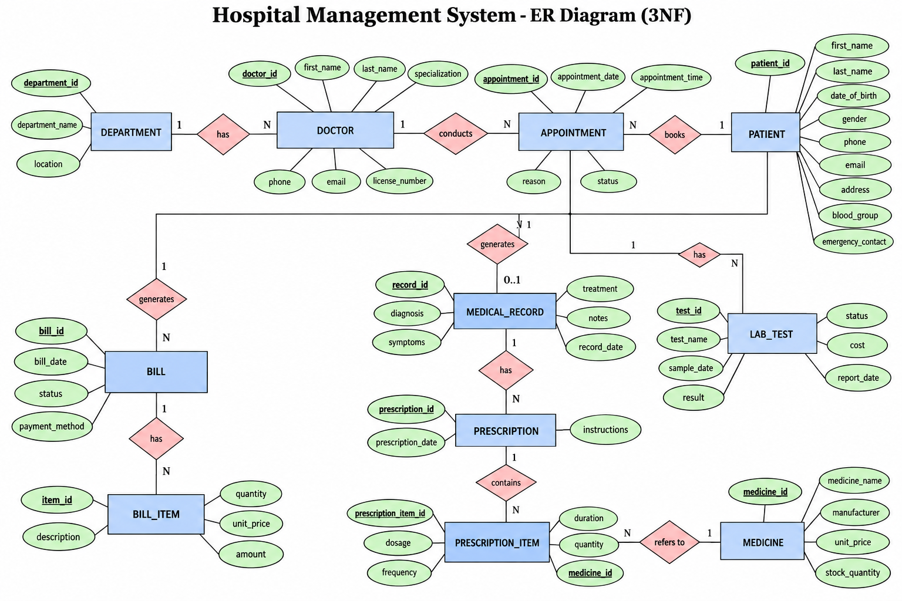
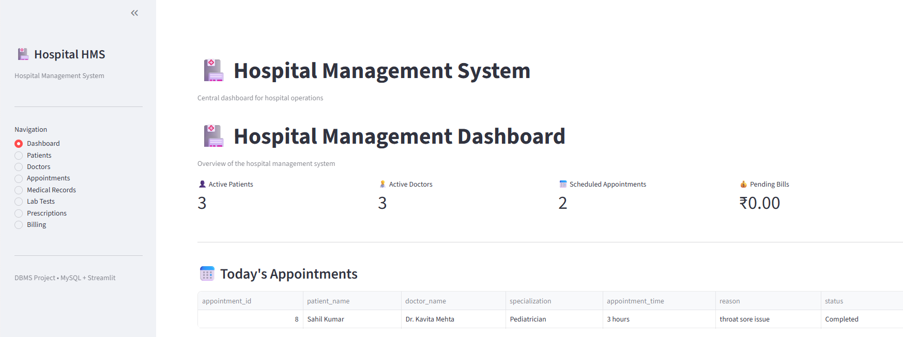

# 🏥 Hospital Management System

A DBMS-based Hospital Management System developed using MySQL,
Python and Streamlit.

## 📌 Project Overview

The Hospital Management System is a normalized relational database
application designed to manage patients, doctors, appointments,
medical records, prescriptions, laboratory tests and billing.

The system provides a Streamlit-based interface for performing
database operations and generating operational information.

## 🛠️ Tech Stack

- MySQL 8.x
- Python
- Streamlit
- MySQL Connector/Python
- SQL
- VS Code

## ✨ Features

### Patient Management
- Add patients
- View patient records
- Update patient information
- Activate/deactivate patients

### Doctor Management
- Add doctors
- View doctors
- Update doctor information
- Activate/deactivate doctors

### Appointment Management
- Book appointments
- View appointments
- Update appointment status
- Scheduled / Completed / Cancelled states

### Medical Records
- Create medical records
- Store diagnosis, symptoms and treatment
- View medical history

### Laboratory Tests
- Add laboratory tests
- Track test status
- Store results and reference ranges

### Prescriptions
- Create prescriptions
- Add medicines to prescriptions
- Track medicine inventory
- Manage dosage, frequency and duration

### Billing
- Create bills
- Add bill items
- Calculate bill totals
- Track payment status and payment method

### Dashboard
- Active patient count
- Active doctor count
- Scheduled appointments
- Pending bills
- Today's appointments
- Pending laboratory tests

## 🗄️ Database Design

The database consists of the following major entities:

- Department
- Patient
- Doctor
- Appointment
- Medical_Record
- Medicine
- Prescription
- Prescription_Item
- Lab_Test
- Bill
- Bill_Item

## 🔗 Relationships

- Department → Doctor : 1:N
- Patient → Appointment : 1:N
- Doctor → Appointment : 1:N
- Appointment → Medical_Record : 1:0..1
- Appointment → Lab_Test : 1:N
- Medical_Record → Prescription : 1:N
- Prescription → Prescription_Item : 1:N
- Medicine → Prescription_Item : 1:N
- Patient → Bill : 1:N
- Bill → Bill_Item : 1:N

## 📐 Normalization

The database is normalized up to Third Normal Form (3NF).

### First Normal Form (1NF)
- Atomic values
- No repeating groups
- Unique records

### Second Normal Form (2NF)
- All non-key attributes depend on the complete primary key
- No partial dependencies

### Third Normal Form (3NF)
- No transitive dependencies
- Non-key attributes depend only on the primary key

## ER Diagram & Dashboard

The database is designed and normalized up to Third Normal Form (3NF).




## 🏗️ Application Architecture

User
↓
Streamlit Interface
↓
Python / MySQL Connector
↓
MySQL Server
↓
Hospital Management Database

## 📁 Project Structure

```text
Hospital-Management-System/
│
├── .streamlit/
│   └── secrets.toml
│
├── app/
│   ├── app.py
│   └── db.py
│
├── database/
│   ├── 01_schema.sql
│   ├── 02_sample_data.sql
│   └── 03_queries.sql
│
├── docs/
│   └── er-diagram.png
│
├── .gitignore
└── README.md